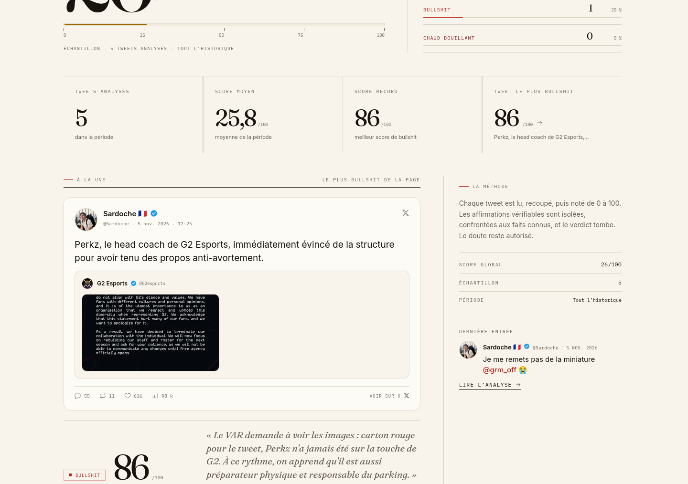
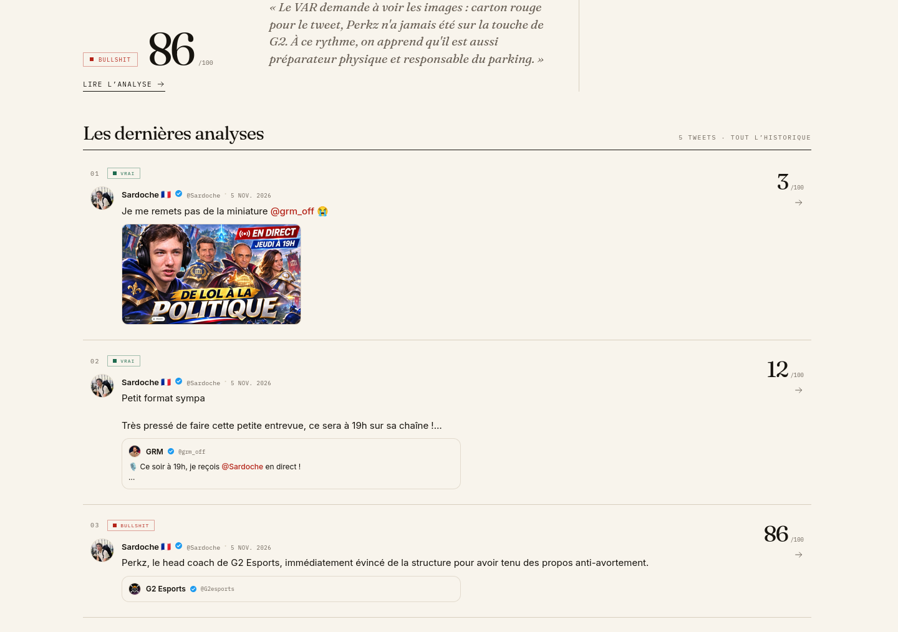

# SardocheMètre

Site satirique qui analyse les tweets de Sardoche et leur attribue un **score de
bullshit de 0 à 100**, avec un verdict, une explication et des fact-checks générés
par IA.

> **Avertissement** : projet satirique et pédagogique, sans affiliation avec Sardoche,
> X/Twitter, Anthropic ou OpenCode. Les analyses sont produites par une IA et peuvent
> être fausses, incomplètes ou injustes. Elles ne constituent pas un fact-checking
> professionnel. Le ton est mordant, l'objectif n'est pas le harcèlement.

## Aperçu

| Accueil — hero et BullshitMètre | Accueil — la une |
| --- | --- |
|  |  |

| Accueil — dernières analyses | Détail — tweet cité |
| --- | --- |
|  |  |

| Détail — tweet avec photo | Accueil mobile |
| --- | --- |
|  |  |

| Détail mobile |
| --- |
|  |

Les captures ont été prises le 6 novembre 2026. Les tweets affichés sont de **vrais
tweets de @Sardoche du 5 novembre 2026**, pas des données de test. Le détail
de l'inventaire se trouve dans [`docs/screenshots/README.md`](docs/screenshots/README.md).

## Fonctionnalités

- **Vrais tweets récents** : la source `profile` lit la page publique `x.com/Sardoche`
  et récupère jusqu'à 5 tweets originaux récents, avec le profil, les médias, les
  tweets cités et les compteurs.
- **Collecte automatique** : un scheduler tourne toutes les 5 minutes
  (`CRON_SCHEDULE=*/5 * * * *`), enregistre les nouveaux tweets et analyse les
  nouveaux venus avec OpenCode. Les tweets déjà collectés restent en base.
- **Embeds X complets** : avatar, nom, badge vérifié bleu, `@handle`, date, texte,
  photos et vidéos, tweet cité, réponses, reposts, j'aime, vues et lien
  « Voir sur X ».
- **BullshitMètre** : score global, niveau, taille de l'échantillon et jauge animée.
- **Statistiques** : score moyen, score minimum et maximum, tweet le plus bullshit et
  répartition des verdicts (`VRAI`, `DOUTEUX`, `BULLSHIT`, `CHAUD BOUILLANT`).
- **Recherche et périodes** : recherche texte, filtres aujourd'hui / cette semaine /
  ce mois / tout l'historique, pagination serveur.
- **Page détail** : grille deux colonnes sur desktop (embed à gauche, score, verdict
  et état de l'IA à droite), analyse, fact-checks et pull quote en pleine largeur.
- **Réanalyse IA** : un bouton permet de relancer l'analyse d'un tweet avec
  DeepSeek V4.1 Flash ; le résultat est persisté.
- **Design éditorial** : fond papier, titres Fraunces, texte Inter, données IBM Plex
  Mono et accent vermillon.
- **404 et états d'erreur** : page inconnue, tweet introuvable, backend indisponible,
  nouvelle tentative, interface responsive et navigation clavier.

## Source des tweets

Une seule application : le frontend appelle le backend, qui interroge X puis stocke
les tweets en base. Aucun sélecteur de source ni jeu de données local n'est affiché
par défaut.

| Source | Usage | Clé requise | Remarque |
| --- | --- | --- | --- |
| `profile` | **Recommandée** : page publique `x.com/Sardoche` | Non | Jusqu'à 5 tweets originaux récents, avec médias, citations et compteurs. |
| `syndication` | Repli | Non | Ancien flux public X ; l'archive y est souvent plus ancienne et moins complète. |
| `x` | API X v2 officielle | `TWITTER_BEARER_TOKEN` | Source la plus robuste, mais soumise aux quotas et à l'offre de l'API X. |
| `mock` | Tests et développement | Non | Tweets de `backend/mock/tweets.json`, jamais utilisés par l'interface en configuration normale. |

### `profile` (source par défaut)

La page publique `https://x.com/Sardoche` contient, dans son HTML rendu côté serveur,
un flux `profile_user_originals_timeline`. À la date de rédaction, elle expose
5 tweets du 5 novembre 2026. Le backend :

1. télécharge la page avec un User-Agent de navigateur ;
2. extrait la chaîne JSON SSR `profile_user_originals_timeline` ;
3. parcourt les entrées, écarte les tweets sans date ou vides et déduplique ;
4. récupère le profil (`name`, `username`, avatar, badge vérifié, followers) ;
5. récupère pour chaque tweet le texte, la date, les compteurs, les médias et le
   tweet cité éventuel ;
6. renvoie au maximum 5 tweets, triés du plus récent au plus ancien.

Un cache mémoire de 60 secondes évite de télécharger la page à chaque requête. Le
scheduler, lui, tourne toutes les 5 minutes, enregistre les tweets dans les tables
`tweets` et `profile`, puis analyse uniquement ceux qui ne le sont pas encore. Les
anciens tweets ne sont pas supprimés : la base constitue une archive au fil du temps.

> **Limite importante** : le parsing du HTML de x.com est **non officiel**. X peut
> changer la structure de sa page, renvoyer une page vide, limiter le débit ou bloquer
> la requête (Cloudflare). Dans ce cas, la source renvoie une liste vide et le cycle
> est journalisé sans faire tomber le serveur. L'API X v2 officielle (`TWITTER_SOURCE=x`
> avec un Bearer Token) reste la voie la plus robuste pour un usage durable.

### `syndication`

Le flux public `syndication.twitter.com` ne demande pas de token. Il sert de repli
quand `profile` échoue ou n'est pas disponible. Il expose généralement des tweets
plus anciens et ne fournit pas les mêmes détails d'embed (médias, citations,
compteurs de réponses et de vues). Utilisez-le comme secours, pas comme source
principale.

### `x` (API officielle)

Avec `TWITTER_SOURCE=x` et `TWITTER_BEARER_TOKEN`, le backend utilise l'API X v2,
résout l'utilisateur par `SARDOCHE_USER_ID` ou `SARDOCHE_USERNAME`, exclut les
réponses et retweets, et récupère jusqu'à `TWITTER_SYNC_LIMIT` tweets. C'est la source
la plus fiable à long terme, mais elle nécessite un accès API et consomme le quota de
votre offre.

### `mock`

La source `mock` charge `backend/mock/tweets.json` et recale les dates au démarrage.
Elle est réservée aux tests automatisés et au développement hors réseau. Elle n'est
pas sélectionnée par la configuration locale et n'apparaît pas dans l'interface.

## Démarrage rapide

### Prérequis

- **Node.js 20 ou plus récent** et npm.
- Une clé **OpenCode** (`oc_sk_...`) pour l'analyse IA.
- Aucune clé X n'est nécessaire avec la source `profile`.
- PostgreSQL est optionnel ; SQLite est utilisé par défaut.

### Tout lancer

```bash
./start-all.sh
```

Le script installe les dépendances si nécessaire, démarre le backend sur le port
`3001`, attend `/health`, puis lance Vite sur `http://localhost:5173`. Il n'y a
qu'une seule application : le frontend lit les tweets et les analyses du backend.

La configuration locale attendue est :

```env
TWITTER_SOURCE=profile
TWITTER_SYNC_LIMIT=5
CRON_SCHEDULE=*/5 * * * *
AI_PROVIDER=opencode
OPENCODE_MODEL=deepseek-v4.1-flash
```

L'application démarre donc avec les **vrais tweets récents de Sardoche**. Le
scheduler vérifie la source toutes les 5 minutes et analyse les nouveaux tweets avec
OpenCode. La clé `OPENCODE_API_KEY` doit être présente dans `backend/.env` ; sans
elle, l'application reste consultable mais le scheduler ne démarre pas et la
réanalyse est désactivée.

### Alias historique

```bash
./start-free.sh
```

Le nom est conservé pour compatibilité, mais le script lance désormais l'application
complète : il n'y a plus de mode gratuit ni de jeu de données local. Il exécute
`start-all.sh` et nécessite la même clé OpenCode pour l'IA.

### Lancement manuel

```bash
# Terminal 1 — backend
cd backend
npm install
npm start

# Terminal 2 — frontend
cd frontend
npm install
npm run dev
```

## Configuration

Les modèles de variables sont fournis dans :

- [`backend/.env.example`](backend/.env.example) ;
- [`frontend/.env.example`](frontend/.env.example).

```bash
cp backend/.env.example backend/.env
cp frontend/.env.example frontend/.env
```

### Backend

Variables principales :

| Variable | Valeur usuelle | Rôle |
| --- | --- | --- |
| `PORT` | `3001` | Port HTTP du backend. |
| `DB_CLIENT` | `sqlite` | `sqlite` ou `postgres`. |
| `SQLITE_PATH` | `./sardochemetre.db` | Chemin de la base SQLite. |
| `DATABASE_URL` | — | Connexion PostgreSQL si `DB_CLIENT=postgres`. |
| `CORS_ORIGIN` | `*` en local | Origine(s) autorisée(s), séparées par des virgules. |
| `ANALYZE_RATE_LIMIT` | `10` | Requêtes d'analyse autorisées par IP et par fenêtre. |
| `ANALYZE_RATE_WINDOW_MS` | `60000` | Durée de la fenêtre de limitation, en millisecondes. |
| `TRUST_PROXY` | — | `1` derrière un proxy de confiance (Railway/Render). |
| `TWITTER_SOURCE` | `profile` | `profile`, `syndication`, `x` ou `mock`. |
| `TWITTER_SYNC_LIMIT` | `5` | Tweets récupérés par cycle (la source `profile` plafonne à 5). |
| `CRON_SCHEDULE` | `*/5 * * * *` | Fréquence du scheduler. |
| `CRON_RUN_ON_START` | `false` | Lance un cycle immédiat au démarrage. |
| `AI_PROVIDER` | `opencode` | Provider d'analyse. |
| `OPENCODE_API_KEY` | `oc_sk_...` | Clé OpenCode, uniquement côté backend. |
| `OPENCODE_MODEL` | `deepseek-v4.1-flash` | Modèle utilisé. |
| `OPENCODE_PLAN` | `payg` ou `go` | Offre OpenCode et URL associée. |
| `OPENCODE_MAX_TOKENS` | `3000` | Limite de génération. |
| `SARDOCHE_USERNAME` | `Sardoche` | Compte suivi. |
| `TWITTER_BEARER_TOKEN` | — | Uniquement avec `TWITTER_SOURCE=x`. |

L'offre **pay-as-you-go** (`OPENCODE_PLAN=payg`) est le choix recommandé pour cette
application. L'offre **Go** est prévue pour les agents de codage ; elle reste
supportée, avec l'en-tête `x-opencode-session` ajouté par le backend. La configuration
locale de ce dépôt utilise une clé Go (`OPENCODE_PLAN=go`) ; le compte pay-as-you-go
n'a pas de crédits. Pour un déploiement public, préférez une clé payg approvisionnée.

La clé OpenCode ne doit **jamais** être exposée au frontend. Aucun secret ne doit
figurer dans une variable `VITE_*`.

### Frontend

| Variable | Valeur usuelle | Rôle |
| --- | --- | --- |
| `VITE_API_URL` | `http://localhost:3001` | URL du backend. |

Les variables `VITE_*` sont figées au démarrage de Vite et au moment du build. Après
modification, redémarrez `npm run dev` ou reconstruisez le frontend.

### Activer DeepSeek V4.1 Flash

1. Créez une clé `oc_sk_...` sur <https://opencode.ai/console>.
2. Dans `backend/.env` :

   ```env
   AI_PROVIDER=opencode
   OPENCODE_API_KEY=oc_sk_...
   OPENCODE_MODEL=deepseek-v4.1-flash
   OPENCODE_PLAN=payg
   ```

3. Redémarrez le backend (`Ctrl+C` puis `./start-all.sh`, ou `./start-backend.sh`).
4. Vérifiez la configuration :

   ```bash
   curl http://localhost:3001/api/ai/status
   # → "configured":true
   ```

Une erreur `402 - Insufficient account funds` signifie que le compte pay-as-you-go
n'a plus de crédits. Ajoutez des crédits dans la console OpenCode, ou utilisez une clé
Go avec `OPENCODE_PLAN=go` si votre usage le permet.

## Tests, lint et build

```bash
# Tests backend
cd backend && npm test

# Tests frontend
cd frontend && npm test

# Lint et build frontend
cd frontend && npm run lint
cd frontend && npm run build

# Vérification complète de l'installation (tests + lint + build)
./test-install.sh
```

État actuel de la suite : **91 tests backend** et **41 tests frontend**, lint et
build sans erreur, et aucune vulnérabilité signalée par `npm audit` au moment de la
rédaction.

`./test-backend.sh` lance les tests backend, puis des smoke tests dynamiques si un
serveur répond déjà sur `http://localhost:3001` : premier tweet de la liste, détail de
ce tweet, recherche d'un mot-clé réel, profil, statistiques et BullshitMètre.

## Architecture

```text
.
├── backend/
│   ├── app.js                 # Factory Express testable (CORS, routes, erreurs)
│   ├── server.js              # Démarrage, arrêt propre, scheduler
│   ├── scheduler.js           # Cron de collecte et d'analyse
│   ├── sync-tweets.js         # Import manuel (--source, --limit, --analyze)
│   ├── db/
│   │   ├── config.js          # Choix SQLite/PostgreSQL
│   │   ├── schema.js          # Schéma, colonnes d'embed et migrations douces
│   │   ├── sqlite.js          # Repository SQLite (tweets, profil, analyses)
│   │   ├── postgres.js        # Pool PostgreSQL
│   │   ├── periods.js         # Fenêtres day/week/month/all
│   │   └── mock-data.js       # Chargement du mock de test
│   ├── routes/                # Routes tweets et IA
│   ├── services/
│   │   ├── twitterService.js  # Sources profile, syndication, x, mock
│   │   ├── opencodeService.js # Appels OpenCode et normalisation
│   │   ├── aiService.js       # Sélection du provider
│   │   └── claudeService.js   # Prompt, parsing et provider Anthropic historique
│   ├── migrations/            # Migrations PostgreSQL (dont profil et embed)
│   ├── mock/tweets.json       # Tweets de test
│   └── test/                  # Tests node:test
├── frontend/
│   ├── src/
│   │   ├── components/        # TweetEmbed, TweetAvatar, VerifiedBadge,
│   │   │                      # TweetMedia, QuotedTweet, TweetText, BullshitMètre…
│   │   ├── lib/               # Normalisation, profil, formatage, calculs
│   │   ├── pages/             # Home, TweetDetail
│   │   └── services/          # Client API (tweets, profil, IA)
│   ├── public/                # Favicon, avatars, rewrites Netlify
│   └── vercel.json            # Rewrite SPA Vercel
├── docs/                      # Documentation de référence
│   └── screenshots/           # Captures de l'application
├── archive/                   # Ancien squelette de projet
├── start-all.sh
├── start-backend.sh
├── start-free.sh
├── test-backend.sh
└── test-install.sh
```

## API

Le backend écoute par défaut sur `http://localhost:3001`. Toutes les réponses sont en
JSON ; les erreurs utilisent la forme `{ "error": "..." }`.

| Méthode | Endpoint | Description |
| --- | --- | --- |
| `GET` | `/health` | `{status, timestamp, mode, database, ai}`. `mode` vaut `demo` ou `production` (compatibilité), `database` `sqlite` ou `postgres`, `ai` expose le provider, le modèle et la configuration. |
| `GET` | `/api/profile` | `{profile}` : `username`, `name`, `avatar_url`, `verified`, `followers`, `updated_at`. `404` si aucun profil n'a encore été collecté. |
| `GET` | `/api/tweets?page=1&limit=20&period=day\|week\|month\|all&q=` | Liste paginée des tweets analysés. Réponse `{tweets, pagination, period, query}` ; `limit` est borné à 100. |
| `GET` | `/api/tweets/stats?period=` | `{period, avgScore, minScore, maxScore, totalAnalyzed, verdictDistribution}`. |
| `GET` | `/api/tweets/bullshitmetre?period=` | `{period, globalScore, level, sampleSize, timestamp}`. Niveaux : `FAIBLE` (< 25), `MODÉRÉ` (< 50), `ÉLEVÉ` (< 75), `CRITIQUE` (≥ 75). |
| `GET` | `/api/tweets/search?q=` | `{tweets, total}` — recherche simple sur le contenu. |
| `GET` | `/api/tweets/:id` | `{tweet}` ou `404` avec `{error}`. |
| `POST` | `/api/tweets/analyze` | Corps `{content, tweet_id?}`. `content` est obligatoire et limité à 1000 caractères. Retourne `{tweet}` si `tweet_id` existe et est en base, sinon `{analysis}`. |
| `GET` | `/api/ai/status` | Provider, modèle, offre et état de configuration. Ne renvoie jamais la clé. |
| `POST` | `/api/ai/analyze` | Analyse un contenu via OpenCode. Répond `503` si la clé manque, `502` si le provider échoue et `429` au-delà de la limite de débit. |

Forme d'un tweet (plate) :

```json
{
  "id": "2118379190474944913",
  "content": "…",
  "posted_at": "2026-11-05T16:25:31.000Z",
  "likes": 608,
  "retweets": 11,
  "replies": 53,
  "views": 97104,
  "source": "profile",
  "author": {
    "name": "Sardoche 🇫🇷",
    "username": "Sardoche",
    "avatar_url": "https://pbs.twimg.com/…",
    "verified": true
  },
  "media": [],
  "quoted_tweet": {
    "id": "2118335170784985252",
    "content": "…",
    "author": {
      "name": "G2 Esports",
      "username": "G2esports",
      "avatar_url": "https://pbs.twimg.com/…",
      "verified": true
    },
    "media": [
      {
        "type": "photo",
        "url": "https://pbs.twimg.com/media/…",
        "width": 1920,
        "height": 2400,
        "expanded_url": "https://x.com/…"
      }
    ]
  },
  "analyzed": true,
  "bullshit_score": 86,
  "verdict": "BULLSHIT",
  "reasoning": "…",
  "fact_checks": [{ "claim": "…", "verdict": "faux", "note": "…" }],
  "humor_comment": "…",
  "analyzed_at": "2026-11-06T14:44:23.799Z"
}
```

`media` est un tableau (0 à 4 éléments affichés) ; `quoted_tweet` vaut `null` quand le
tweet ne cite personne. `author` peut être `null` sur d'anciennes lignes, auquel cas
le frontend retombe sur le profil global.

## Déploiement

L'application n'est plus déployable en site purement statique : les tweets viennent
de la base et les analyses du backend.

- **Frontend statique** : Vercel ou Netlify, build `npm run build`, dossier `dist`.
  Les rewrites SPA sont fournis (`frontend/vercel.json` et
  `frontend/public/_redirects`). Renseignez `VITE_API_URL` vers le backend.
- **Backend** : Railway ou Render, avec `OPENCODE_API_KEY`, `AI_PROVIDER`,
  `OPENCODE_MODEL`, `OPENCODE_PLAN`, `TWITTER_SOURCE=profile` et
  `CRON_SCHEDULE=*/5 * * * *`.
- **Base** : disque persistant pour SQLite, ou PostgreSQL pour éviter le disque.
- **CORS** : `CORS_ORIGIN` doit contenir l'origine exacte du frontend.
- **Scheduler** : une seule instance backend doit l'exécuter.

Le détail est dans [`docs/DEPLOYMENT.md`](docs/DEPLOYMENT.md).

## Limites connues

- **Source `profile` non officielle** : le parsing du HTML de x.com peut casser si X
  modifie sa page. X peut aussi renvoyer une page vide, limiter le débit ou bloquer
  la requête. L'API X v2 officielle est la solution durable.
- **Cinq tweets par cycle** : la source `profile` est plafonnée à 5 tweets. Les
  tweets plus anciens ne sont récupérés que s'ils apparaissent encore dans la page ou
  via une autre source ; la base ne grandit donc que des tweets observés.
- **IA faillible** : le modèle peut se tromper, inventer une source ou mal interpréter
  un tweet. Les réponses invalides sont rejetées, pas les erreurs de jugement.
- **Repli de test** : le service d'analyse conserve un fallback déterministe utilisé
  par les tests. L'interface ne le déclenche pas (le bouton de réanalyse est masqué
  sans clé), mais un appel direct à `POST /api/tweets/analyze` sans configuration IA
  peut produire une analyse simulée. Protégez la route et vérifiez
  `GET /api/ai/status`.
- **Coût et offre** : les appels OpenCode sont facturés. Le payg est recommandé ; Go
  est supporté mais destiné aux agents de codage. Un compte sans crédits renvoie
  `402`.
- **Pas d'authentification** : les routes restent publiques. Les deux routes
  d'analyse facturées sont limitées à 10 requêtes par IP et par minute
  (`ANALYZE_RATE_LIMIT`, `ANALYZE_RATE_WINDOW_MS`), avec un compteur en mémoire
  propre à chaque instance. Une limitation partagée entre plusieurs instances ou une
  authentification restent à prévoir pour une exposition à grande échelle.
- **CORS** : `CORS_ORIGIN=*` par défaut en local ; à restreindre en production.
- **SQLite** : mono-instance, nécessite un disque persistant. Le mode WAL crée des
  fichiers `-wal` et `-shm` à côté de la base.
- **PostgreSQL** : implémenté, mais non validé ici faute de serveur de test.
- **Recherche** : simple sous-chaîne, sans index plein texte.

## Documentation

| Document | Contenu |
| --- | --- |
| [`docs/SETUP.md`](docs/SETUP.md) | Installation, variables, SQLite/PostgreSQL, sources de tweets, dépannage. |
| [`docs/ARCHITECTURE.md`](docs/ARCHITECTURE.md) | Flux de données, source `profile`, base, scheduler, IA et sécurité. |
| [`docs/AI_MODE.md`](docs/AI_MODE.md) | OpenCode, plans payg/Go, coûts, endpoints et dépannage. |
| [`docs/DEPLOYMENT.md`](docs/DEPLOYMENT.md) | Vercel, Netlify, Railway, Render, PostgreSQL, disque persistant, CORS. |
| [`docs/screenshots/README.md`](docs/screenshots/README.md) | Inventaire des captures et contexte des tweets affichés. |
| [`docs/archive/README.md`](docs/archive/README.md) | Documents historiques conservés mais potentiellement obsolètes. |
| [`CLAUDE.md`](CLAUDE.md) | Contexte synthétique pour les assistants de développement. |

## Licence et affiliation

Le `package.json` du backend déclare une licence `ISC` ; aucun fichier `LICENSE`
n'est présent à la racine du dépôt. Le frontend est marqué `private`.

Projet satirique sans affiliation avec Sardoche, X/Twitter, Anthropic ou OpenCode.
